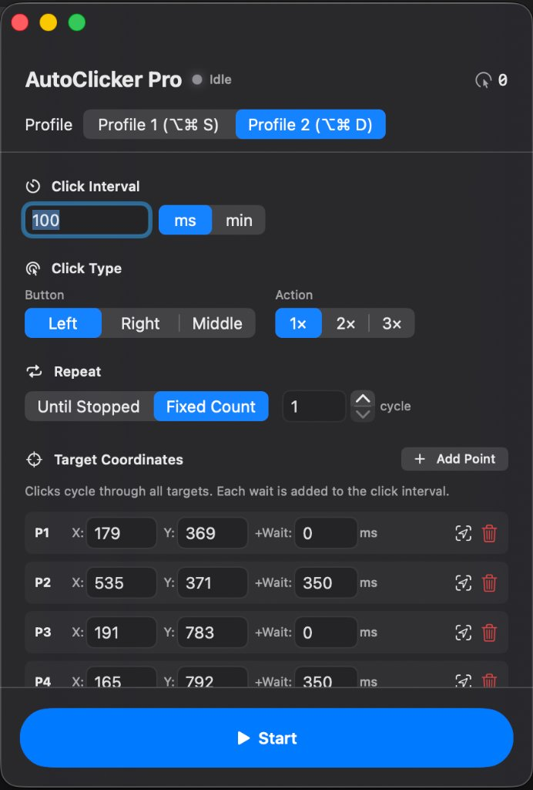

# AutoClicker Pro for macOS

<p align="center">
  
</p>

**AutoClicker Pro** is a high-performance, precision mouse automation utility designed natively for macOS. Built with Swift and SwiftUI, it combines microsecond-level event timing, multi-point coordinate sequencing, and multi-profile workflow management behind a clean, Human Interface Guidelines (HIG)-compliant interface.

---

## Table of Contents
- [Key Features](#key-features)
- [Architecture & Detailed Breakdown](#architecture--detailed-breakdown)
  - [1. Dual Profile System](#1-dual-profile-system)
  - [2. Multi-Point Coordinate Sequencing](#2-multi-point-coordinate-sequencing)
  - [3. Click Modes & Timing Controls](#3-click-modes--timing-controls)
  - [4. Global Hotkey Engine & Emergency Stop](#4-global-hotkey-engine--emergency-stop)
  - [5. Safety & System Protection](#5-safety--system-protection)
- [How to Use](#how-to-use)
- [Installation & Building](#installation--building)
- [Accessibility Permissions](#accessibility-permissions)
- [Technical Specifications](#technical-specifications)

---

## Key Features

- **Dual Independent Profiles:** Instantly switch between two fully distinct automation sequences (**Profile 1** and **Profile 2**), each with its own coordinates, timing, buttons, and dedicated global keyboard shortcut.
- **Dedicated Global Hotkeys:**
  - `⌥⌘ S` (Option + Command + S) toggles **Profile 1**.
  - `⌥⌘ D` (Option + Command + D) toggles **Profile 2**.
  - Pressing `⌥⌘ D` while Profile 1 is running cleanly stops Profile 1 and starts Profile 2 without delay or cursor lock.
- **Universal Emergency Killswitch:** Pressing `⎋ Esc` instantly halts any running sequence from any application context.
- **Multi-Target Coordinate Sequencing:** Define an ordered queue of targets ($P_1 \to P_2 \to \dots \to P_n$) with individual coordinate pickers and custom per-point delays.
- **Repeat Limits (Cycle-Aware):** Choose between continuous clicking (*Until Stopped*) or running $N$ complete cycles through all configured target points (*Fixed Count*).
- **Flexible Button & Action Support:** Left, Right, or Middle mouse buttons with Single (`1x`), Double (`2x`), or Triple (`3x`) clicks.
- **Cursor Movement Safety Interrupt:** Automatically halts automation if the user physically moves the mouse by more than $15\text{ px}$.
- **Native macOS Experience:** Lightweight Swift implementation, Dark Mode support, and direct integration with macOS Accessibility APIs.

---

## Architecture & Detailed Breakdown

```
┌─────────────────────────────────────────────────────────────────┐
│                        AutoClicker Pro                          │
├────────────────────────────────┬────────────────────────────────┤
│       Profile 1 (⌥⌘ S)         │        Profile 2 (⌥⌘ D)        │
│  - Interval: 100 ms            │  - Interval: 50 ms             │
│  - Button: Left (1x)           │  - Button: Right (2x)          │
│  - Repeat: Until Stopped       │  - Repeat: 5 Cycles            │
│  - Targets: [P1, P2]           │  - Targets: [P1, P2, P3, P4]   │
└────────────────────────────────┴────────────────────────────────┘
                                 │
                 ┌───────────────┴───────────────┐
                 ▼                               ▼
       ┌───────────────────┐           ┌───────────────────┐
       │   HotkeyManager   │           │    ClickEngine    │
       │  (CGEventTap)     │           │  (Quartz Events)  │
       │  - ⌥⌘S / ⌥⌘D Map  │           │  - Warp + Move    │
       │  - ⎋ Esc Override │           │  - Token Guards   │
       └───────────────────┘           └───────────────────┘
```

### 1. Dual Profile System
AutoClicker Pro includes two separate, persistent automation profiles:
- **Profile 1** (Default: `⌥⌘ S`)
- **Profile 2** (Default: `⌥⌘ D`)

Each profile stores independent configuration parameters, including interval timing, mouse buttons, action multipliers, cycle limits, and coordinate target lists. Switching profiles via the segmented control at the top of the window immediately updates the interface and configures the active sequence. 

When a hotkey is triggered:
- If idle, the corresponding profile starts immediately.
- If the triggered profile is already active, it stops.
- If the other profile is currently running, the engine cleanly halts the active sequence and immediately starts the new profile without cursor race conditions.

### 2. Multi-Point Coordinate Sequencing
Instead of clicking only at static or random positions, AutoClicker Pro supports multi-point choreography:
- **Interactive Coordinate Capture:** Click the crosshair icon (`⌖`) on any target point to capture screen coordinates directly by clicking anywhere on your display.
- **Per-Point Wait Delays (`+Wait: N ms`):** Add extra dwell time after specific clicks (e.g., $P_1$ clicks, waits $0\text{ ms}$; $P_2$ clicks, waits $350\text{ ms}$ for an animation to complete before moving to $P_3$).
- **Hit-Testing & Window Server Sync:** Uses `CGWarpMouseCursorPosition` coupled with synthetic `mouseMoved` events so macOS window server hit-testing and hover states update synchronously for background applications.
- **True Cycle Execution:** Setting a limit of `Fixed Count: 2` executes 2 full cycles through all configured points ($P_1 \to P_2 \to P_3 \to P_1 \to P_2 \to P_3$) rather than terminating after 2 individual clicks.

### 3. Click Modes & Timing Controls
- **Interval Values & Units:** Milliseconds (`ms`) or Minutes (`min`) with safety guards enforcing a minimum threshold of $1\text{ ms}$.
- **Mouse Buttons:** Left, Right, and Middle clicks.
- **Action Multipliers:**
  - `1x`: Single click (MouseDown $\to$ MouseUp).
  - `2x`: Double click with OS-compliant inter-click timing ($10\text{ ms}$ hold, $20\text{ ms}$ release).
  - `3x`: Triple click for selecting entire paragraphs or tri-state controls.

### 4. Global Hotkey Engine & Emergency Stop
- **CGEventTap Architecture:** A dedicated high-priority background thread listens for global key events, ensuring responsiveness even when target games or full-screen apps are in the foreground.
- **Collision Prevention:** Live hotkey validation guarantees that Profile 1 and Profile 2 cannot be assigned conflicting shortcuts.
- **Universal Escape Killswitch:** Pressing `⎋ Esc` is treated as a priority override that immediately aborts any running sequence without swallowing `Esc` from other apps.

### 5. Safety & System Protection
- **Mouse Movement Interrupt:** When *"Stop if mouse moves"* is enabled, physical movement of the mouse by more than $15\text{ px}$ during execution trips a safety tripwire, instantly releasing mouse buttons and halting automation.
- **Run-Token Isolation:** Rapid hotkey switching uses generation tokens (`runToken`) to drop stale asynchronous UI callbacks from previous sequences.
- **Rate-Cap Stability Warning:** Alerts the user when interval thresholds drop below $2\text{ ms}$ to prevent system unresponsiveness.

---

## How to Use

1. **Select a Profile:** Click **Profile 1** or **Profile 2** in the top segmented bar.
2. **Set Interval:** Enter your click delay (e.g., `100 ms`).
3. **Configure Button & Action:** Select **Left**, **Right**, or **Middle** button, and choose **1x**, **2x**, or **3x**.
4. **Define Repeat Limit:**
   - Choose **Until Stopped** to click indefinitely.
   - Choose **Fixed Count** and enter the number of full cycles to execute.
5. **Add Target Coordinates:**
   - Click **+ Add Point** to append target points.
   - Click the crosshair icon to pick a screen coordinate.
   - Specify any additional wait time (`+Wait: N ms`) required after that target.
6. **Start / Stop Automation:**
   - Click the blue **▶ Start** button in the footer, or
   - Press **`⌥⌘ S`** for Profile 1, or **`⌥⌘ D`** for Profile 2.
   - Press **`⎋ Esc`** at any time to emergency stop.

---

## Installation & Building

### Prerequisites
- macOS 12.0 (Monterey) or later
- Xcode 15.0+ or Command Line Tools
- [XcodeGen](https://github.com/yonaskolb/XcodeGen) (`brew install xcodegen`)

### Building from Source

```bash
# Clone the repository
git clone https://github.com/your-username/autoclicker.git
cd autoclicker

# Generate the Xcode project
xcodegen generate

# Run unit tests
xcodebuild -project AutoClickerPro.xcodeproj -scheme AutoClickerPro -destination 'platform=macOS' test

# Build application
xcodebuild -project AutoClickerPro.xcodeproj -scheme AutoClickerPro -destination 'platform=macOS' build
```

---

## Accessibility Permissions

Because AutoClicker Pro generates synthetic Quartz mouse events and registers a system-wide `CGEventTap` for global hotkeys, macOS requires Accessibility authorization:

1. When opening the app for the first time, an **Accessibility Permission Required** banner will appear.
2. Click **Open System Settings**.
3. Navigate to **Privacy & Security $\to$ Accessibility**.
4. Enable the toggle for **AutoClicker Pro**.
5. The permission banner will automatically dismiss and hotkey listeners will activate.

> **Developer Note on TCC Permissions:**  
> The project includes a custom post-build script (`scripts/resign.sh`) that signs the binary with a stable self-signed local certificate (`AutoClickerDev`). This prevents macOS from invalidating Accessibility permissions each time the app is rebuilt.

---

## Technical Specifications

| Parameter | Specification |
| :--- | :--- |
| **Operating System** | macOS 12.0+ (Universal: Apple Silicon & Intel) |
| **Language & Framework** | Swift 5.9, SwiftUI, Combine |
| **Input Generation** | Quartz Event Services (`CGEventCreateMouseEvent`, `CGEventPost`) |
| **Cursor Warping** | `CGWarpMouseCursorPosition` with synthetic `mouseMoved` hit-testing |
| **Hotkey Capture** | `CGEventTap` on dedicated high-priority run loop |
| **Minimum Interval** | $1\text{ ms}$ (enforced by `SafetyGuard`) |
| **Movement Interrupt** | $15\text{ px}$ threshold |
| **Testing** | 100% passing XCTest suite covering models, stores, hotkeys, and cycles |

---

## License

MIT License. See [LICENSE](LICENSE) for details.

